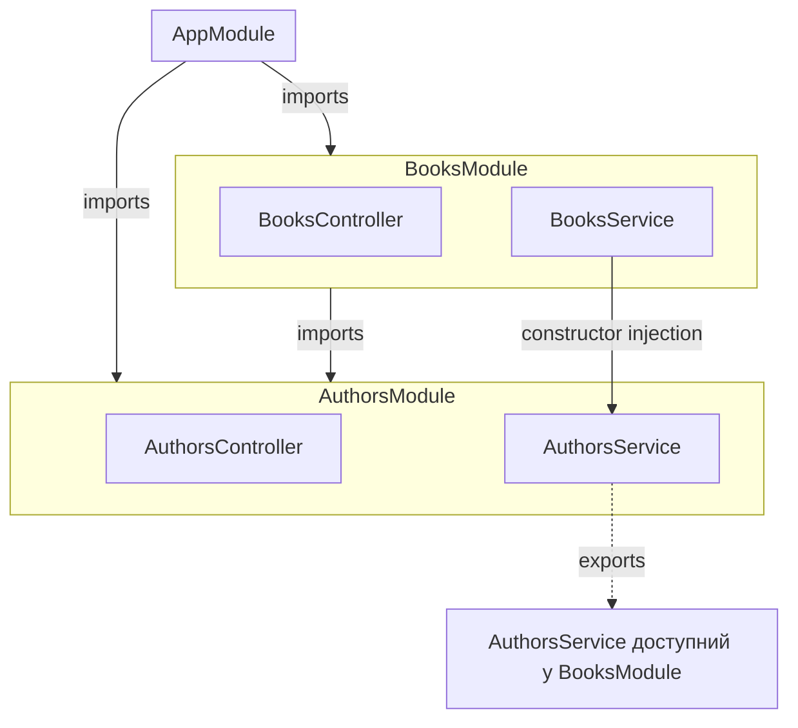

# 05. Модулі: imports / providers / controllers / exports

## 1. Мета

Після цієї теми студент зможе:

- пояснити призначення всіх чотирьох секцій `@Module({...})`;
- розбити застосунок на кілька модулів за доменом (books/authors);
- використати сервіс з іншого модуля через `imports` + `exports`;
- намалювати граф модулів свого застосунку.

## 2. Таймінг на уроці

| Хвилини | Що показуємо |
|---|---|
| 100-105 | Теорія: чотири секції `@Module`, навіщо ділити на модулі |
| 105-110 | `AuthorsModule` - звичайний модуль з `exports` |
| 110-112 | `BooksModule` імпортує `AuthorsModule` і використовує `AuthorsService` |

## 3. Теорія

Модуль - це "коробка", яка групує пов'язаний код і явно каже, **що
з неї видно ззовні**. У `@Module({...})` чотири секції:

| Секція | Що означає |
|---|---|
| `controllers` | Контролери, що належать цьому модулю |
| `providers` | Сервіси (і інші `@Injectable()`-класи), створені в цьому модулі |
| `imports` | Інші модулі, чиї **експортовані** провайдери потрібні тут |
| `exports` | Які зі своїх `providers` цей модуль дозволяє використовувати іншим |

Головне правило: **провайдер видно за межами свого модуля тільки
якщо він явно в `exports`**. Якщо модуль A хоче використати сервіс з
модуля B, модуль A повинен (1) імпортувати B (`imports: [B]`), а
модуль B повинен (2) експортувати потрібний сервіс (`exports: [...]`).
Без обох кроків - помилка `Nest can't resolve dependencies`.



## 4. Що змінилось порівняно з попередньою темою

У темі 04 був один модуль (`AppModule`) з одним контролером і одним
сервісом. Тепер домен розбитий на два модулі: `BooksModule` і
`AuthorsModule`, кожен зі своїм контролером і сервісом.
`AppModule` більше нічого не реєструє сам - лише імпортує обидва
модулі. `Book` тепер зберігає `authorId` замість рядка `author`, а
`BooksService` звертається до `AuthorsService` з іншого модуля, щоб
підставити ім'я автора у відповідь і перевірити, що автор існує
перед створенням книжки.

## 5. Розбір коду

- **`src/authors/authors.module.ts`** - "звичайний" модуль:
  `controllers`, `providers`, і головне - `exports: [AuthorsService]`.
- **`src/authors/authors.service.ts`**, **`authors.controller.ts`** -
  CRUD авторів, той самий стиль, що й `BooksService`/`BooksController`
  у темі 04.
- **`src/books/books.module.ts`** - `imports: [AuthorsModule]` -
  тільки завдяки цьому рядку `BooksService` може отримати
  `AuthorsService`.
- **`src/books/books.service.ts`** - конструктор з `AuthorsService`
  як другим прикладом Dependency Injection (тема 04 показала DI
  всередині одного модуля, тут - між модулями); метод `withAuthor()`
  підставляє ім'я автора в кожну книжку перед поверненням клієнту.
- **`src/app.module.ts`** - тільки `imports: [BooksModule, AuthorsModule]`.

## 6. Express vs Nest

| | Express | Nest |
|---|---|---|
| "Модуль" як концепція | Немає вбудованої - папки й файли, об'єднані вручну (naming convention) | `@Module()` - формальна одиниця з явним API (exports) |
| Поділитись сервісом між частинами застосунку | Імпортувати файл (`require('../authors/service')`) напряму | Імпортувати модуль (`imports: [AuthorsModule]`), сервіс підставляється сам |
| Що видно ззовні "коробки" коду | Усе, що не `require`-приватне (по суті, усе) | Тільки те, що в `exports` |

## 7. Як запустити

```bash
# з кореня репозиторію
npm run start:05
```

```bash
curl http://localhost:3005/books
curl http://localhost:3005/authors
curl -X POST http://localhost:3005/books -H "Content-Type: application/json" \
  -d '{"title":"Інтернат","authorId":1,"year":2017}'
```

Повний список - у [`requests.http`](./requests.http).

## 8. Типові помилки

- **`Nest can't resolve dependencies of the BooksService (?). Please make
  sure that the argument AuthorsService at index [0] is available in the
  BooksModule context.`** - `BooksModule` не імпортує `AuthorsModule`
  (забули `imports: [AuthorsModule]`).
- **Та сама помилка, але `AuthorsModule` імпортовано** - `AuthorsModule`
  не експортує `AuthorsService` (забули `exports: [AuthorsService]`).
  Це найчастіша плутанина теми: "я ж імпортував модуль!" - імпорт
  модуля не робить видимими його провайдери автоматично, потрібен
  ще й `exports` у модулі-джерелі.
- **`A circular dependency has been detected (property: ...)`** -
  зустрінете у вправі 3: два модулі імпортують один одного напряму.
  Рішення - `forwardRef()` (детальніше - у `exercises/TASKS.md` і
  офіційній документації в розділі 11).

## 9. Питання для самоперевірки

1. Що станеться, якщо модуль A імпортує модуль B, але B не експортує потрібний сервіс?
   <details><summary>Відповідь</summary>Помилка `Nest can't resolve dependencies` - сам імпорт модуля не робить видимими всі його провайдери, видимі лише ті, що явно в `exports`.</details>

2. Чи може один модуль одночасно бути і в `imports` AppModule, і сам імпортувати інший модуль?
   <details><summary>Відповідь</summary>Так, саме так влаштований BooksModule - він у imports AppModule і сам імпортує AuthorsModule.</details>

3. Навіщо `Book` зберігає `authorId`, а не повне ім'я автора рядком?
   <details><summary>Відповідь</summary>Щоб уникнути дублювання даних про автора в кожній книжці і мати єдине джерело правди (AuthorsService) - типовий підхід до зв'язку "багато до одного".</details>

4. Що таке циклічна залежність модулів?
   <details><summary>Відповідь</summary>Ситуація, коли модуль A імпортує модуль B, а модуль B одночасно імпортує модуль A - Nest не може визначити порядок створення без додаткової підказки (forwardRef).</details>

5. Чим `providers` відрізняється від `exports` у `@Module()`?
   <details><summary>Відповідь</summary>`providers` - де класи створюються (реєструються як провайдери цього модуля); `exports` - які з уже зареєстрованих providers дозволено використовувати модулям, що імпортують цей модуль.</details>

## 10. Практика

Завдання - у [`exercises/TASKS.md`](./exercises/TASKS.md), розв'язки -
у [`exercises/solutions/`](./exercises/solutions/).

## 11. Корисні посилання

- [NestJS - Modules](https://docs.nestjs.com/modules)
- [NestJS - Circular dependency](https://docs.nestjs.com/fundamentals/circular-dependency)
- [NestJS - Module reference](https://docs.nestjs.com/fundamentals/module-ref)
