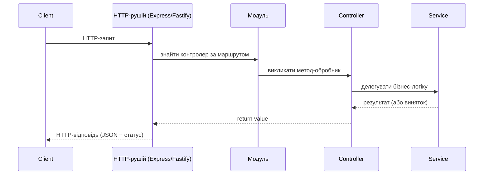

# 06. Підсумок

## 1. Мета

Після цієї теми студент зможе:

- відтворити у голові всю мапу "Express → Nest" з уроку;
- намалювати (на словах) життєвий цикл одного HTTP-запиту в Nest;
- назвати 3-4 теми, які логічно вивчати далі, і чому саме їх.

## 2. Таймінг на уроці

| Хвилини | Що показуємо |
|---|---|
| 112-116 | Мапа Express → Nest - один погляд на весь урок |
| 116-119 | Життєвий цикл запиту в Nest (діаграма) |
| 119-120 | Що вивчати далі |

## 3. Теорія

### 3.1. Мапа «Express → Nest»

| Express | Nest | Де в уроці |
|---|---|---|
| `server.js` з усім підряд | `main.ts` + модулі | [00](../00-why-nest/), [02](../02-first-nest-app/) |
| `app.get(path, handler)` | `@Get(path)` на методі контролера | [03](../03-controllers/) |
| `req.params`, `req.query`, `req.body` | `@Param()`, `@Query()`, `@Body()` | [03](../03-controllers/) |
| `res.status(code).json(data)` | `return data` (+ `@HttpCode()` за потреби) | [03](../03-controllers/) |
| Ручний виклик `new Service()` | Dependency Injection (`@Injectable()` + конструктор) | [04](../04-services-and-di/) |
| Файли й папки "за домовленістю" | `@Module()`: `imports`/`providers`/`controllers`/`exports` | [05](../05-modules/) |

### 3.2. Життєвий цикл запиту в Nest

Спрощена версія (без Guards/Pipes/Interceptors - вони попереду):

Повний життєвий цикл у реальному Nest-застосунку додає ще Middleware
(до цього), Guards (перевірка прав), Interceptors (до і після),
Pipes (перетворення й валідація даних) і Exception Filters (обробка
помилок) - саме вони в наступному пункті.

### 3.3. Що вивчати далі

| Тема | Навіщо | Документація |
|---|---|---|
| **Pipes** (`ParseIntPipe`, `ValidationPipe`) | Автоматична валідація й перетворення вхідних даних - замінить ручний `Number(id)` з теми 03 | [docs.nestjs.com/pipes](https://docs.nestjs.com/pipes) |
| **class-validator + DTO** | Декларативна валідація тіла запиту (`@IsString()`, `@IsInt()` прямо в DTO) | [docs.nestjs.com/techniques/validation](https://docs.nestjs.com/techniques/validation) |
| **Guards** | Авторизація/автентифікація - хто має доступ до маршруту | [docs.nestjs.com/guards](https://docs.nestjs.com/guards) |
| **Interceptors** | Логування, трансформація відповіді, кешування "навколо" обробника | [docs.nestjs.com/interceptors](https://docs.nestjs.com/interceptors) |
| **Exception filters** | Централізована й узгоджена обробка помилок замість `throw` по всьому коду | [docs.nestjs.com/exception-filters](https://docs.nestjs.com/exception-filters) |
| **Підключення бази даних (TypeORM/Prisma/Mongoose)** | Замінити масив у пам'яті на справжнє збереження даних | [docs.nestjs.com/techniques/database](https://docs.nestjs.com/techniques/database) |
| **Testing (`@nestjs/testing`)** | Юніт- і e2e-тести контролерів/сервісів з підміною залежностей | [docs.nestjs.com/fundamentals/testing](https://docs.nestjs.com/fundamentals/testing) |

## 9. Питання для самоперевірки

1. Назвіть три речі, які Nest "вирішив за вас" порівняно з чистим Express.
   

Відповідь
Наприклад: структура коду (контролери/сервіси/модулі), спосіб передачі залежностей (DI замість ручного `new`), спосіб оголошення маршрутів (декоратори замість `app.get`).

2. У якому порядку Nest створює BooksController, BooksService, AuthorsService з теми 05?
   

Відповідь
Спочатку все, від чого залежать інші (AuthorsService - у нього немає залежностей), потім BooksService (залежить від AuthorsService), і насамкінець BooksController (залежить від BooksService) - IoC-контейнер будує граф і йде від "листків" до "коренів".

3. Чому в прикладах цього курсу не було Pipes, хоча вони "напрошувались" у темі 03?
   

Відповідь
Щоб не вводити надто багато нових понять за один урок - Pipes природньо продовжують тему валідації вхідних даних, яку варто вивчати окремо, спираючись на вже знайомі контролери й DTO.

4. Яка тема з "Що вивчати далі" найкраще розв'яже проблему ручного `Number(id)` + перевірки `NaN` з теми 03?
   

Відповідь
Pipes, зокрема вбудований `ParseIntPipe`.

## 11. Корисні посилання

- [NestJS - Documentation (повний зміст)](https://docs.nestjs.com/)
- [NestJS - Pipes](https://docs.nestjs.com/pipes)
- [NestJS - Validation](https://docs.nestjs.com/techniques/validation)
- [NestJS - Guards](https://docs.nestjs.com/guards)
- [NestJS - Interceptors](https://docs.nestjs.com/interceptors)
- [NestJS - Exception filters](https://docs.nestjs.com/exception-filters)
- [NestJS - Database (TypeORM/Prisma/Mongoose)](https://docs.nestjs.com/techniques/database)
- [NestJS - Testing](https://docs.nestjs.com/fundamentals/testing)
